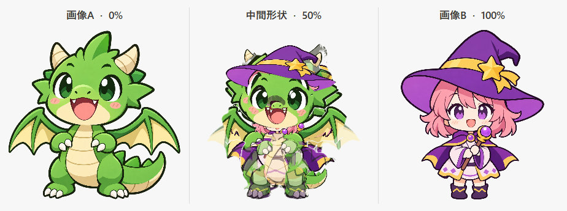

# モーフィング（SYNC_Morphing）

**v1.0.0** · AviUtl ExEdit2 2.1.2 以降 · Windows 64 ビット

2枚の画像の輪郭やパーツを対応させ、中間の形を作りながら切り替えるメディアオブジェクトです。顔のパーツや手足を別々に動かせます。片側だけにあるパーツは、輪郭を指定すると形を変えながら出現・消滅します。

## インストール

1. AviUtl2 を終了して、配布されている `SYNC_Morphing.zip` を解凍します。
2. 中の `SYNC_Morphing` フォルダーを AviUtl2 のアプリケーションデータフォルダー内の `Plugin` に置きます。標準の配置先は `%ProgramData%\aviutl2\Plugin\SYNC_Morphing` です。
3. AviUtl2 を起動します。

## 使い方

1. タイムラインにメディアオブジェクト「モーフィング」を追加し、「画像A」と「画像B」を選びます。対応点が未設定なら、画像の輪郭と検出できた特徴から自動判定します。
2. 項目「モーフィング」に AviUtl2 標準の移動を設定し、`0` から `100` に変化させます。0% と 100% ではそれぞれ元の画像を表示します。
3. 「設定」を開くと、スライダーで中間形状を確認できます。タイトルバーの × または `Alt+F4` で表示中の内容を保存し、`Esc` で今回の変更を破棄します。

## 動きを調整する

- **パーツの位置をそろえる** — 左の領域一覧で対象を選び、「編集」→「対応点を編集」で、A・B の同じ場所をクリックします。既存の点はドラッグで動かせます。
- **片側だけにあるパーツを出す・消す** — 「領域を追加」で領域を作り、「輪郭を編集」で存在する側に3点以上を置きます。「領域設定」で、B にだけあるものは「出現」、A にだけあるものは「消滅」にします。両側に対応する顔の輪郭がある場合、帽子は頭に沿って立ち上がります。
- **中間フレームを直す** — プレビューで変形率を選び、「補正キーを追加」（`Ctrl+K`）で対応点や領域のメッシュを動かします。「表示」メニューから画像ごとの位置合わせ、境界ぼかし、プレビュー画質も調整できます。

## 自動判定と Codex 詳細判定

「判定」→「自動判定」（`Ctrl+D`）で、2枚の画像をローカルで再判定できます。部位をさらに細かく判定するには「Codexで詳細判定」（`Ctrl+Shift+D`）を選びます。詳細判定では選択中の2枚の画像を Codex に送信するため、ログイン済みの Codex CLI とインターネット接続が必要です。結果は設定画面で確認してから適用できます。

## 設定の保存と持ち出し

対応点、領域、補正キーなどは AviUtl2 のプロジェクトに保存されます。画像はファイルへの参照なので、別のPCに移す場合は画像も一緒に移してください。「ファイル」→「JSONを保存」「JSONを開く」で設定を他のオブジェクトへ移せます。

[ライセンス](LICENSE) · [第三者ライセンスと由来](THIRD_PARTY_NOTICES.md)
